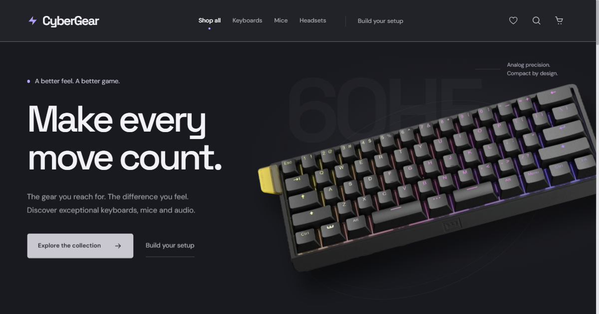

# CyberGear — Performance Studio

A product-led storefront for keyboards, mice and audio. Graphite product stages, silver catalog surfaces and restrained motion, built with semantic HTML, CSS and vanilla JavaScript modules.

[Live demo](https://shevdevworks.github.io/cyber-gear/)



## The experience

- Interactive keyboard study with a layered assembly sequence, three models, an exploded view and pointer-responsive camera.
- Visual category navigation and a graphite filter panel with a catalog price histogram, dual range handles, exact inputs and budget presets.
- Search, category/connection/RGB/price filters, sorting and grid/list views.
- Product details with shareable hash URLs, image zoom, specifications and related gear.
- Saved products persisted in local storage, with a dedicated collection view.
- Interactive setup builder: a shared 3D desk, perspective/overhead views, three presets, selectable components, live totals and one-click addition to the cart.
- Persistent cart, quantity controls and percentage/fixed demo promo codes.
- Simulated checkout with field validation, country dialing codes, courier/pickup options and an explicit demo confirmation.
- Free demo courier delivery at $200 or more after discounts; otherwise $5. Pickup is free.
- Keyboard-accessible dialogs and drawers, managed focus and reduced-motion support.

## Run locally

No installation or build step is required. Three.js is vendored locally and loaded on demand. Serve the repository over HTTP:

```sh
python -m http.server 4173 --bind 127.0.0.1
```

Open [localhost:4173](http://127.0.0.1:4173). ES modules require HTTP; opening the HTML directly as a file will not work. Hard-refresh after editing if your static server or browser caches modules.

## Verification

Run the state and filtering regression tests with Node.js:

```sh
node --test tests/store.test.mjs tests/price-range.test.mjs
```

The tests cover saved-item persistence, saved/category filter combinations, setup quantities, stock restrictions, quantity limits, percentage/fixed promo calculations, non-mutating sorting and price-input boundaries.

Browser checks cover the shopping flow, mobile filters, focus containment, product navigation, setup presets/cart totals, reduced motion, missing WebGL and viewport widths from 320 to 3840 px. Scenes were also checked at a 1920 × 1080 CSS viewport with 2x pixel density (3840 × 2160 output).

## Structure

```text
index.html                  Page, setup builder, cart and checkout markup
css/variables.css           Shared design tokens
css/components/             Component styles and studio layout
js/app.js                   Application wiring, navigation and layer management
js/modules/studio.js        Spotlight, setup builder, saved view and product dialogs
js/modules/product-scenes.js  Geometry, materials, lighting and on-demand rendering
js/vendor/three/            Pinned Three.js 0.186.1 distribution and MIT license
js/modules/catalog.js       Filtering, sorting and keyed card rendering
js/modules/store.js         State, cart, wishlist and promo calculations
js/modules/cart.js          Cart rendering and controls
js/modules/checkout.js      Validation and simulated order flow
js/data/products.js         Sample catalog
js/utils/                   Formatting, storage and notifications
tests/store.test.mjs        State and filtering regression tests
tests/price-range.test.mjs  Price bounds and crossed-handle regression tests
```

## Demo boundaries

This is an independent portfolio concept. There is no backend, payment provider, real order creation or fulfillment. Checkout fields stay in browser memory and are not submitted to a server. Use sample details when testing.

Cart and saved product IDs remain in this browser's local storage. Filters reset on reload. Product imagery, names and trademarks belong to their respective owners; prices, ratings, availability and specifications are sample data. Google Fonts is the only external runtime asset service.

The 3D views are stylized product studies, not manufacturer CAD or exact representations of the listed products. Original photographs remain in product cards and detail views. The monitor, desk and stand are scene props, not cart items. Rendering follows display density up to 2x, pauses offscreen and in idle/hidden tabs, and respects reduced motion. Product photographs remain usable when WebGL or the optional rendering module is unavailable.

Built by [ShevDevWorks](https://github.com/shevdevworks).
